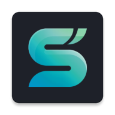

# Vela Filmes

<p align="center">
  
</p>

<p align="center">
  Aplicativo para Android TV e dispositivos móveis, com filmes, séries e TV ao vivo.
</p>

## Sobre o projeto

O Vela Filmes é um aplicativo para Android que reúne filmes, séries e canais de TV ao vivo em uma única interface.

A proposta é oferecer uma navegação simples e organizada, permitindo encontrar conteúdos por gênero, ano, categoria e outros filtros.

Os filmes e séries podem ser reproduzidos em áudio original, com legendas ou dublados em português, dependendo da disponibilidade das fontes.

O aplicativo também possui uma seção dedicada à televisão ao vivo, integrada à mesma interface.

O desenvolvimento é voltado principalmente para Android TV e TV Box, mas o aplicativo também funciona em smartphones e tablets Android.

O projeto surgiu a partir do Streamflix, criado por Lory-Stan TANASI, e passou por modificações e adaptações para atender às necessidades do Vela Filmes.

## Funcionalidades

- Catálogo de filmes e séries organizado por categorias.
- Pesquisa e filtros por gênero, ano e outros critérios.
- Reprodução de conteúdos em áudio original ou dublado.
- Suporte a legendas e seleção de idioma.
- Canais de televisão ao vivo.
- Player integrado com controles de reprodução.
- Histórico e opção de continuar assistindo.
- Organização de séries por temporadas e episódios.
- Diferentes temas para personalização da interface.
- Navegação por controle remoto em Android TV.
- Interface adaptada para dispositivos móveis.
- Integração com fontes externas de conteúdo.

Algumas funcionalidades dependem da disponibilidade das fontes e da compatibilidade do dispositivo.

## Tecnologias utilizadas

O aplicativo é desenvolvido em Kotlin, utilizando o Android Studio como ambiente de desenvolvimento.

As principais tecnologias e bibliotecas utilizadas são:

- Kotlin
- Android SDK e AndroidX
- Media3 / ExoPlayer
- Retrofit
- OkHttp
- Jsoup
- Glide
- Kotlin Coroutines
- Leanback
- Gradle

## Compilação

Para compilar o aplicativo, é necessário ter o Android Studio, o Android SDK e uma versão compatível do JDK instalados.

Depois de obter o código-fonte, abra o projeto no Android Studio e aguarde a sincronização das dependências.

Configure o arquivo `local.properties` com as informações necessárias para os serviços utilizados pelo aplicativo.

Para gerar uma versão de desenvolvimento, execute na raiz do projeto:

```powershell
.\gradlew assembleDebug --no-configuration-cache
```

O APK gerado ficará normalmente em:

```text
app/build/outputs/apk/debug/app-debug.apk
```

## Desenvolvimento

O Vela Filmes está em desenvolvimento e recebe alterações frequentes.

O trabalho envolve melhorias na interface, organização do catálogo, reprodução de vídeos, integração de fontes e compatibilidade com diferentes versões do Android.

Uma das prioridades é manter uma boa experiência em televisores e TV Boxes, inclusive nos dispositivos com hardware mais limitado.

## Créditos

O Vela Filmes foi desenvolvido a partir do projeto Streamflix e de sua continuação comunitária, Streamflix Reborn.

O projeto original foi criado por [Lory-Stan TANASI](https://github.com/stantanasi).

O código original e as contribuições anteriores são reconhecidos e preservados conforme as condições de suas respectivas licenças.

## Aviso legal

O Vela Filmes utiliza informações e recursos disponibilizados por serviços e fontes externas.

Os direitos sobre filmes, séries, canais, imagens e demais conteúdos pertencem aos seus respectivos titulares.

O aplicativo não concede autorização para acessar ou distribuir conteúdos protegidos por direitos autorais. Cada usuário é responsável por utilizar fontes e serviços de maneira legal.

## Licença

O projeto original Streamflix foi disponibilizado sob a licença Apache 2.0.

As condições de licença e os avisos de autoria aplicáveis ao código derivado devem ser preservados. Consulte o arquivo [LICENSE](LICENSE) para mais informações.
